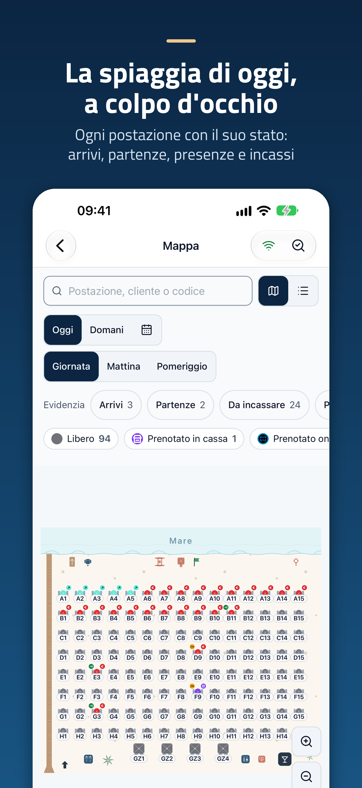
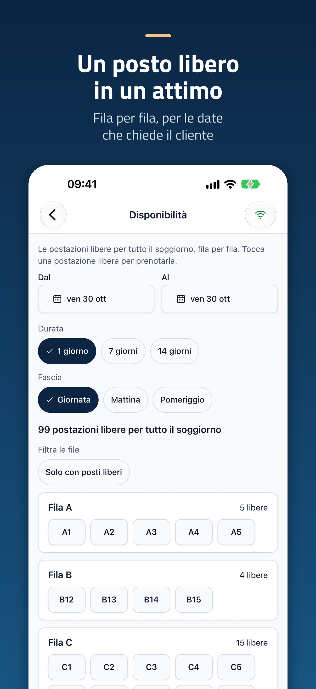
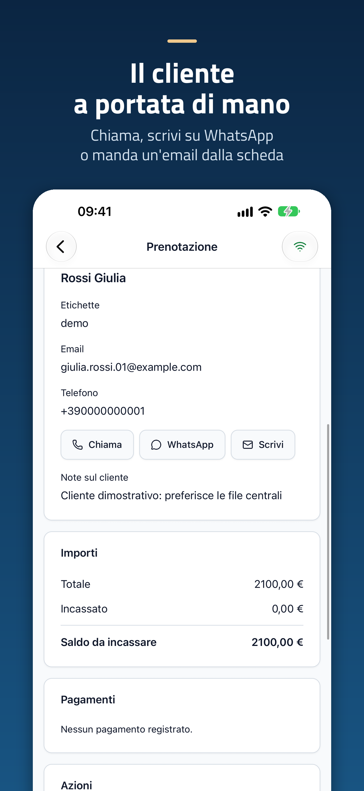
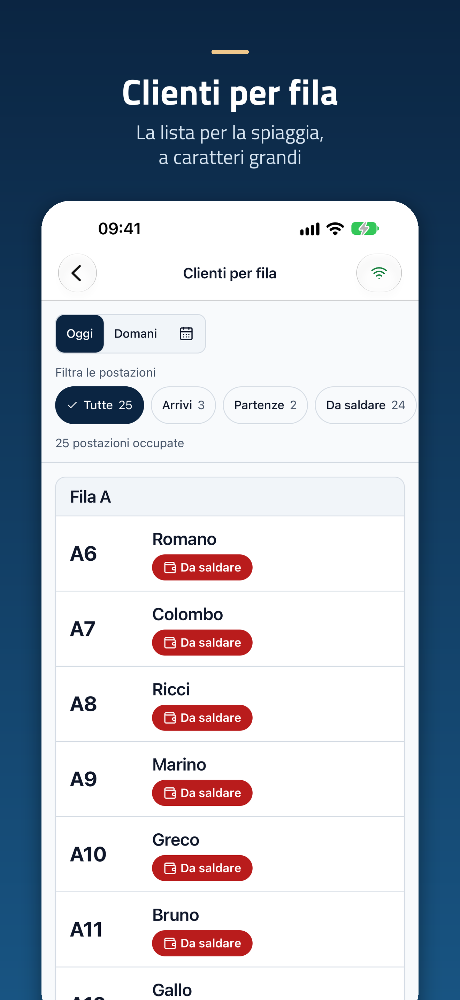
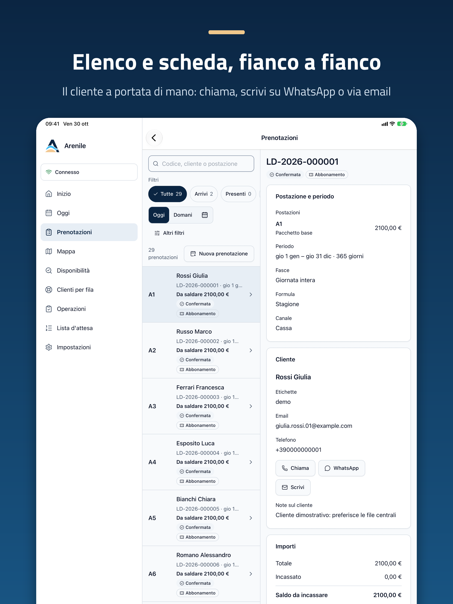

# Arenile mobile

L'app per lo staff degli stabilimenti balneari che usano [Arenile](https://arenile.app), il gestionale
con codice sorgente disponibile di Coste360 SRL. Si collega alla **tua** istanza Arenile (VPS, hosting
gestito o app desktop in rete locale) con il QR code del pannello: non ha un server predefinito e non
invia dati a Coste360. Solo il pulsante **Prova la demo** collega, su richiesta, lo stabilimento di
esempio di Coste360 (ADR 0015).

<p align="center">
  
  
  
  
</p>

<p align="center">
  
</p>

Le immagini per App Store e Google Play sono in [`store/`](store/README.md).

## Cosa fa oggi

**Collegamento (fase 0)**

- **Collega a un'istanza** inquadrando il QR di _Configurazione → Dispositivi → Abbina un dispositivo_
  (anche con la fotocamera di sistema: il link `arenile://pair?d=…` apre l'app) oppure digitando indirizzo
  e codice di abbinamento.
- Verifica che l'istanza sia Arenile e compatibile (`GET /api/admin/v1/meta`): versione minima di Arenile
  supportata **1.0.0**; avvisa anche quando è l'app a dover essere aggiornata.
- Conserva il token del dispositivo nel portachiavi (Keychain / Keystore). Se il dispositivo viene
  revocato dal pannello, l'app lo spiega e torna alla schermata di collegamento.
- Si collega anche all'app desktop in **rete locale** (certificato autogenerato): accetta solo il
  certificato con l'impronta del QR, avvisa prima del rinnovo e chiede di riabbinare dopo
  ([ADR 0006](docs/adr/0006-rete-locale-desktop-certificato-autofirmato.md), modulo nativo
  [`modules/pinned-fetch`](modules/pinned-fetch/README.md)). Serve la build dell'app (EAS Build): in Expo
  Go la rete locale del desktop non è disponibile.
- Impostazioni: lingua (italiano, inglese, tedesco, francese), tema chiaro/scuro, _Scollega questo
  dispositivo_. Layout per telefono e per tablet/iPad (pannello di navigazione laterale).

**Il lavoro del giorno (fase 1)**

- **Oggi:** arrivi, presenti, postazioni libere, da saldare e giorni rilasciati, ognuno apre l'elenco
  filtrato.
- **Prenotazioni del giorno** di oggi o domani con filtri, ricerca e ordinamento, e la scheda della
  prenotazione (su tablet elenco e scheda affiancati).
- **Mappa del giorno** con i colori di stato del pannello (sempre con simbolo ed etichetta), zoom e
  spostamento con i gesti, ricerca, vista a elenco, scheda della postazione
  ([ADR 0008](docs/adr/0008-mappa-del-giorno-renderer-svg.md)).
- **Operazioni:** check-in dal QR della prenotazione o del biglietto o dal codice, ingresso al varco,
  rilascio del giorno degli abbonati, note, incasso in contanti, blocco delle postazioni
  ([ADR 0009](docs/adr/0009-operazioni-check-in-qr-e-azioni-solo-online.md)).
- **Offline:** mappa e prenotazioni di oggi e domani restano consultabili; check-in, rilasci, note e
  incassi in contanti vanno in coda con chiavi di idempotenza e partono alla riconnessione; indicatore
  della connessione sempre visibile ([ADR 0007](docs/adr/0007-offline-cache-e-coda-delle-operazioni.md)).

**Fase 2** ([ADR 0011](docs/adr/0011-fase-2-vendita-spostamenti-lista-attesa-stampa-push.md), tutto solo online)

- Vendita giornaliera rapida dalla mappa, spostamento di una prenotazione, lista d'attesa con l'offerta
  di un posto, stampa del biglietto sulla stampante ESC/POS del pannello (edizione desktop).

**Fase 3** ([ADR 0010](docs/adr/0010-report-essenziali-e-widget.md))

- Report essenziali (incassato, occupazione, prenotazioni e prenotato rispetto all'anno precedente) per
  titolare, gestore e sola lettura.
- Widget della schermata principale di iOS e Android con i conteggi di oggi, letti dalla cache.

Ogni azione segue i permessi del ruolo come nel pannello: ciò che il ruolo non può fare non compare, e
un rifiuto del server si mostra come "non consentito".

**Da provare su dispositivo prima del rilascio:** rete locale del desktop (modulo nativo mai compilato
per intero), gesti della mappa con centinaia di postazioni, fotocamera, widget, permessi di sistema,
stampa su una stampante reale.

**Notifiche push: non in questa edizione.** L'app rilegge i dati dall'istanza quando viene aperta o torna
in primo piano. Le notifiche push richiederebbero un relay centrale gestito da Coste360 e potranno
diventare una funzione di una futura edizione a pagamento
([ADR 0012](docs/adr/0012-niente-notifiche-push-nell-edizione-pubblica.md)).

## Privacy

L'app parla solo con la tua istanza (o, se lo scegli con **Prova la demo**, con la demo di Coste360,
[ADR 0015](docs/adr/0015-prova-la-demo.md)): nessuna telemetria, nessun SDK di analisi, pubblicità o crash
reporting, nessun aggiornamento remoto del codice ([ADR 0005](docs/adr/0005-privacy-niente-telemetria-ne-aggiornamenti-remoti.md)).
Nessuna notifica push, quindi nessun identificativo del telefono dato ad Apple, Google o Coste360
([ADR 0012](docs/adr/0012-niente-notifiche-push-nell-edizione-pubblica.md)).

## Sviluppo

Prerequisiti: Node.js 22+, npm 10+, `make`. Non servono Xcode né Android SDK: le build native si fanno
con EAS Build.

```bash
make setup   # npm ci
make dev     # Metro (Expo): build di sviluppo o Expo Go
make check   # contratto generato aggiornato + lint + guardia degli stili + tsc + test (< 2 min)
make         # tutti i comandi
```

| Comando                        | Quando                                                                                              |
| ------------------------------ | --------------------------------------------------------------------------------------------------- |
| `make check`                   | Dopo ogni modifica                                                                                  |
| `make check-full`              | Prima di aprire una pull request: aggiunge `expo-doctor` e la compilazione dei bundle iOS e Android |
| `make gen`                     | Dopo aver cambiato la release del core fissata                                                      |
| `make api-bump VERSION=vX.Y.Z` | Per passare al contratto API di un'altra release del core                                           |

Il contratto API è l'`openapi.yaml` della release del core indicata in `api/core-version.json` (oggi
**v1.1.3**), verificato con SHA-256; i tipi TypeScript in `src/api/generated/` si generano con
`make gen` e non si modificano a mano ([ADR 0002](docs/adr/0002-repository-separato-e-contratto-api.md)).

Per provare l'app su un dispositivo serve una **build di sviluppo** con EAS Build, progetto
`@coste360/arenile-mobile`: `npx eas-cli build --profile development --platform ios|android` (profili in
`eas.json`: `development`, `development-simulator`, `preview`, `production`; nessun canale di
aggiornamento remoto, ADR 0005). Fotocamera e portachiavi sono inclusi anche in Expo Go per provare i flussi
base con `make dev`.
Per un'istanza locale usa `http://localhost:8080` dal simulatore o un indirizzo `https` (ad esempio un
tunnel) dal telefono: l'app accetta `http` solo su loopback.

Leggi [AGENTS.md](AGENTS.md) (regole del progetto, anche per gli agenti AI), gli [ADR](docs/adr/README.md)
e [CONTRIBUTING.md](CONTRIBUTING.md).

## Struttura

```
src/app/            rotte expo-router (collega, scansione, manuale, collegamento, area collegata)
src/api/            client API unico, trasporto, errori tipizzati; generated/ = tipi dal contratto
src/features/       abbinamento, sessione, dati, offline, mappa, operazioni, fase 2, report, widget
modules/pinned-fetch/ modulo nativo locale: trasporto con pinning per il desktop in rete locale
src/widgets/        layout del widget della schermata principale (expo-widgets)
src/components/     componenti dell'app; ui/ = React Native Reusables
src/i18n/           i18next, lingue it (sorgente), en, de, fr
docs/spec/          piano dell'app per fasi
docs/adr/           decisioni
```

## Da fare prima della pubblicazione

- **Marchio:** icona, icona adattiva Android, schermata di avvio e simbolo nell'app vengono dal kit
  ufficiale del core (`assets/brand` del core, ADR 0018 del core). Gli asset del marchio non sono coperti
  dalla licenza del codice ([assets/brand/NOTICE.md](assets/brand/NOTICE.md)). Da verificare con il
  marchio: varianti dedicate per l'icona adattiva e per la schermata di avvio (oggi derivate dal simbolo
  ufficiale con margini) e le schede degli store.
- **Account:** Expo/EAS (build e invio), Apple Developer Program e Google Play Console di Coste360,
  identificativo `app.arenile.mobile` (progetto EAS `@coste360/arenile-mobile` collegato; prima build di
  sviluppo Android avviata, per iOS manca ancora il team Apple Developer); per il widget iOS anche l'estensione
  `app.arenile.mobile.ExpoWidgetsTarget` e l'app group `group.app.arenile.mobile` (ADR 0010).
- **Build e prove su dispositivo:** una build di sviluppo EAS per iOS e Android (servono per
  `expo-sqlite`, il modulo `modules/pinned-fetch` e l'estensione del widget), poi
  le prove su iPhone, iPad e Android elencate nel [piano dell'app](docs/spec/README.md); il test JUnit del
  modulo Android (`./gradlew :pinned-fetch:testDebugUnitTest` in un progetto generato con prebuild).
- **Kit della mappa:** le illustrazioni dei kit del core non sono ancora usate (ADR 0008): servono una
  release del core che le pubblichi come asset versionato compatibile con la licenza dell'app.

## Licenza

Codice sotto la **Business Source License 1.1** ([LICENSE](LICENSE)), con gli stessi parametri del core:
il progetto è _source available_, e ogni versione passa alla GNU AGPL v3.0 o successive tre anni dopo la
sua prima pubblicazione ([ADR 0017](docs/adr/0017-licenza-bsl.md)). L'uso in produzione è libero per gli
stabilimenti balneari gestiti direttamente; servizi a terzi e prodotti concorrenti richiedono una licenza
commerciale (info@coste360.it). Nome, simbolo e icone di Arenile non sono coperti dalla licenza del
codice ([assets/brand/NOTICE.md](assets/brand/NOTICE.md)).

## Contatti

Coste360 SRL — [arenile.app](https://arenile.app). Vulnerabilità: [SECURITY.md](SECURITY.md).
